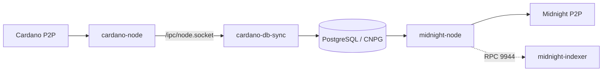

# Midnight Runbook

This stack runs the following components:

- Cardano relay
- `cardano-db-sync`
- PostgreSQL
- Midnight full node
- optional Midnight indexer (archive node required)

The examples use `preview`. For another network, set `cardano:network` and
`midnight-node:network` to the same value and update the Midnight bootnodes.

## Architecture



`cardano-node` and DB Sync share a pod and an `emptyDir` for the socket. DB Sync
writes to the `cardano-db` CNPG cluster. The Midnight node runs in its own
namespace and connects to `cardano-db-rw.cardano`.

## Before you start

The core stack must provide:

- Longhorn with `longhorn-large` (see [storage](./docs/longhorn.md))
- CloudNativePG
- Traefik or Tailscale

```sh
pulumi stack init lab-cardano

# Get the exact value from the core stack:
#   cd ../.. && pulumi stack ls -Q
pulumi config set orangelab:routingProvider traefik   # or tailscale
pulumi config set orangelab:coreStackRef <core-stack-ref>

# Generate the DB password once; keep it stable across restores.
pulumi config set --secret cardano:db/password "$(openssl rand -hex 32)"

# Optional: pin all Cardano/Midnight pods to one node.
pulumi config set cardano:requiredNodeLabel kubernetes.io/hostname=<node>
pulumi config set midnight-node:requiredNodeLabel kubernetes.io/hostname=<node>
```

## Phase 1: Start Cardano

On a new stack:

```sh
pulumi up --yes
```

For a clean restart, destroy the existing stack first. Dynamic volumes are
deleted with the stack and replay from genesis; named volumes survive. Confirm
the storage mode before destroying:

```sh
pulumi destroy --yes
pulumi up --yes
```

DB Sync replays Cardano from genesis; allow several hours.

The first ~10 minutes are initialization: CNPG runs `initdb`, DB Sync creates
its schema, and Cardano begins downloading blocks. Do not snapshot or clone
storage before the database is initialized.

The first update creates:

- namespace `cardano`
- cardano-node + DB Sync pod
- CloudNativePG cluster `cardano-db`
- PVCs for Cardano data, DB Sync state, and PostgreSQL

DB Sync starts when the node socket exists. It follows the node and catches up.

## Phase 2: Verify Cardano and DB Sync

```sh
./scripts/cardano-cli.sh query tip
./scripts/db-sync-progress.sh
```

Wait for `"syncProgress": "100.00"`. `latest_block` must match the `block` from
the tip query and keep increasing.

Compare heights, not `sync_percent`: the percentage compares the newest indexed
block's timestamp to wall-clock time, so a DB Sync hours behind still reads
~99%.

If stuck:

```sh
kubectl -n cardano logs deploy/cardano -c db-sync --tail=100
```

## Phase 3: Deploy Midnight

```sh
pulumi config set midnight-node:nodeName <node-name>
pulumi config set midnight-node:enabled true
pulumi up
```

`nodeName` must be unique on the network. The node reads the DB Sync database and
starts importing Midnight blocks.

On first start against an empty `cardano-midnight` volume, Midnight creates
indexes in the DB Sync database. The `tx_out` index can take several minutes and
may exceed the 100-second startup probe, causing a restart.

```sh
kubectl -n midnight-node logs deploy/midnight-node -f
```

A healthy node shows peers and a `best: #` value that increases. `Syncing` means
catch-up, not a fault; it ends when `best` reaches `target`.

`/health` is on the pod IP because the component runs with `--rpc-cors all`. The
probes use `/health`; it returns 200 while syncing, so readiness means the RPC is
up, not that the node is caught up.

```sh
kubectl -n midnight-node port-forward deploy/midnight-node 9944:9944
curl -s http://localhost:9944/health
```

## Optional: Midnight indexer

The [indexer](./components/midnight-indexer/midnight-indexer.md) exposes
GraphQL. It is not part of FNO onboarding and needs archive pruning: the default
node is pruned, so rebuild it with `--state-pruning archive` first.

```sh
pulumi config set midnight-indexer:secret "$(openssl rand -hex 32)" --secret
pulumi config set midnight-indexer:enabled true
pulumi up
```

The indexer inherits the node network and RPC endpoint and indexes from genesis
on its own volume. The API is cluster-only; use `kubectl port-forward`.

## Gotchas

| Gotcha                                | Detail                                                                                                                          |
| ------------------------------------- | ------------------------------------------------------------------------------------------------------------------------------- |
| `CARDANO_SECURITY_PARAMETER=432`      | Preview is **432**; preprod and mainnet use **2160**. This stack sets 432.                                                      |
| Cardano 10.6.2 vs 11.0.1              | DB Sync 13.7.1.0 needs Cardano 11.0.1. Do not mix doc versions.                                                                 |
| Unix socket paths                     | Node uses `/ipc/node.socket`; DB Sync uses `/node-ipc/node.socket`. Same volume; this stack co-locates them.                    |
| DB Sync takes hours                   | Replays from genesis; allow several hours. Start it first.                                                                      |
| `relation "ma_tx_out" does not exist` | Midnight started before DB Sync created its schema. Disable Midnight until DB Sync is at the tip; it will crash-loop otherwise. |
| `No latest block on chain`            | DB Sync is not caught up. Wait; do not restart Midnight repeatedly.                                                             |
| CNPG app user                         | The app role is not a superuser by default; this stack grants `SUPERUSER` for DB Sync.                                          |
| PostgreSQL SSL                        | Midnight needs TLS by default; this stack sets `ALLOW_NON_SSL=true` inside the cluster.                                         |
| Mithril                               | Not automated. Cardano DB is only ~12 GiB, so DB Sync remains the long pole.                                                    |
| RPC exposure                          | 9944 has unsafe methods. Service is cluster-only and `--rpc-methods safe` applies. Do not publish it.                           |
| Root containers                       | Upstream images run as root and write to volumes. Single-node convenience; harden for production.                               |
| `pulumi destroy` and storage          | Dynamic volumes are deleted; named volumes survive. Confirm `fromVolume` settings before destroying.                            |
| Storage clone too early               | Wait until CNPG `initdb` and DB Sync have created their schema (~10 minutes). Never clone an empty `cardano-db` volume.         |

## Limitations

- Full node, not a validator.
- DB Sync from genesis; Mithril is not automated.
- PostgreSQL uses CNPG defaults, not FNO tuning.
- One Longhorn replica; no HA. See [storage](./docs/longhorn.md).
- This repo depends on the published `@orangelab/pulumi` package and the core
  OrangeLab stack.

## See also

- [Longhorn storage](./docs/longhorn.md)
- [Security and key management](./SECURITY.md)

## References

- [FNO Preprod Docs](https://www.notion.so/midnightfoundation/FNO-Preprod-Docs-3374057b9f2380258fb1d69ac7e55816)
- [Set up Cardano node](https://docs.midnight.network/nodes/cardano-node)
- [Set up Cardano DB Sync](https://docs.midnight.network/nodes/cardano-db-sync)
- [Set up full node](https://docs.midnight.network/nodes/full-node)
- [Midnight node releases](https://github.com/midnightntwrk/midnight-node/releases)
- [Cardano DB Sync storage requirements](https://github.com/IntersectMBO/cardano-db-sync#system-requirements)
- [Mithril bootstrap](https://mithril.network/doc/manual/getting-started/bootstrap-cardano-node)
