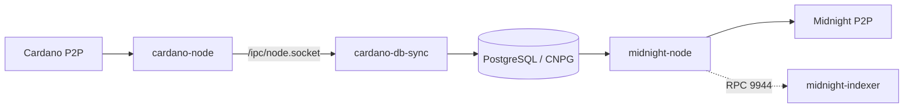

# Midnight FNO Runbook

This stack runs the public half of Midnight FNO onboarding:

- Cardano relay
- `cardano-db-sync` into PostgreSQL
- Midnight full node
- optional Midnight indexer (archive node required)

The examples use `preprod`. For another network, set `cardano:network` and
`midnight-node:network` to the same value and update the Midnight bootnodes.

The stack stops at a **fully synced full node**. Validator mode is optional and
documented in [docs/validator.md](./docs/validator.md).

## Captured state

Two UTC-stamped captures and the capture script live in
[`evidence/`](./evidence). See [evidence/README.md](./evidence/README.md) for
heights, files, and the progression check.

## Architecture



`cardano-node` and DB Sync share a pod and an `emptyDir` for the socket. DB Sync
writes to the `cardano-db` CNPG cluster. The Midnight node runs in its own
namespace and connects to `cardano-db-rw.cardano`.

## Hardware

| Resource | Minimum                | Comfortable          |
| -------- | ---------------------- | -------------------- |
| CPU      | 8 cores, 2.5 GHz       | 16 cores, 3.0 GHz    |
| RAM      | 32 GiB                 | 64 GiB               |
| Storage  | 500 GiB NVMe, 20k IOPS | 1 TiB NVMe, 60k IOPS |
| Network  | 500 Mbps               | 1 Gbps               |
| OS       | Ubuntu 24.04 LTS       | Ubuntu 24.04 LTS     |

The OS row applies to a bare-metal FNO host. These components run as containers;
host OS matters only for WireGuard.

On preprod: Cardano DB ~12 GiB, PostgreSQL ~16 GiB, DB Sync ledger ~2 GiB. The
stack allocates 120Gi to `cardano`, 50Gi to `cardano-db`, and 250Gi to
`cardano-midnight`.

## Versions

| Component       | Version  | Why                                                      |
| --------------- | -------- | -------------------------------------------------------- |
| Cardano node    | 11.0.1   | Required by DB Sync 13.7.1.0 after the Van Rossem change |
| Cardano DB Sync | 13.7.1.0 | Current Midnight pairing                                 |
| Midnight node   | 1.0.400  | Current release used by this stack                       |
| PostgreSQL      | 17.11    | Midnight docs target PostgreSQL 17                       |

The FNO page says Cardano 10.6.2. The Midnight docs pair 11.0.1 with DB Sync
13.7.1.0, so this stack uses those. Change both together and resync.

## Before you start

The core stack must provide:

- Longhorn with `longhorn-large` (see [storage](./docs/longhorn.md))
- CloudNativePG
- Traefik or Tailscale

```sh
pulumi stack init lab-cardano

# Get the exact value from the core stack:
#   cd ../.. && pulumi stack ls -Q
pulumi config set orangelab:routingProvider traefik   # or tailscale
pulumi config set orangelab:coreStackRef <core-stack-ref>

# Generate the DB password once; keep it stable across restores.
pulumi config set --secret cardano:db/password "$(openssl rand -hex 32)"

# Optional: pin all Cardano/Midnight pods to one node.
pulumi config set cardano:requiredNodeLabel kubernetes.io/hostname=<node>
pulumi config set midnight-node:requiredNodeLabel kubernetes.io/hostname=<node>
```

## Storage

Named Longhorn volumes hold the app data; PostgreSQL is cloned to a named volume
after initialization:

| Volume                     | Size  | Contents                                       |
| -------------------------- | ----- | ---------------------------------------------- |
| `cardano`                  | 120Gi | Node `/data/db` + DB Sync `/var/lib/cexplorer` |
| `cardano-db`               | 50Gi  | PostgreSQL                                     |
| `cardano-midnight`         | 250Gi | Midnight node `/node`                          |
| `cardano-midnight-indexer` | 250Gi | Indexer `/data`; optional                      |

The volumes use `dataLocality: best-effort`, the Longhorn node tag `cardano`
(the Cardano node), and the disk tag `ssd` (local NVMe). The DB starts on the dynamic
`longhorn-cardano-db` StorageClass, then is cloned to `cardano-db` after CNPG
`initdb` and DB Sync schema creation. See
[Longhorn storage](./docs/longhorn.md).

`pulumi destroy` keeps named volumes; `pulumi up` reattaches them. Only the first
DB bootstrap uses a dynamic volume. The app volumes are static.

## Phase 1: Start Cardano

On a new stack:

```sh
pulumi up --yes
```

For a clean restart, destroy the existing stack first. Named volumes survive;
delete them only for a full replay from genesis:

```sh
pulumi destroy --yes
pulumi up --yes
```

This starts the long pole: DB Sync replays Cardano from genesis, six hours or
more on preprod.

The first ~10 minutes are initialization: CNPG runs `initdb`, DB Sync creates
its schema, and Cardano begins downloading blocks. Do not snapshot or clone
storage before the database is initialized.

The first update creates:

- namespace `cardano`
- cardano-node + DB Sync pod
- CloudNativePG cluster `cardano-db`
- PVCs for Cardano data, DB Sync state, and PostgreSQL

DB Sync starts when the node socket exists. It follows the node and catches up;
it does not wait for the tip.

After the first blocks are indexed, clone the dynamic DB volume to `cardano-db`
once, then keep it static:

```sh
pulumi config set cardano:storageOnly true
pulumi up
kubectl annotate cluster cardano-db -n cardano cnpg.io/hibernation=on
# wait for the DB pod to disappear and its volume to detach
# create cardano-db from the dynamic volume; see docs/longhorn.md
pulumi config set cardano:db/fromVolume cardano-db
pulumi config set cardano:db/requiredVolumeLabel kubernetes.io/hostname=<node>
kubectl -n cardano delete pvc cardano-db-1
kubectl -n cardano delete cluster cardano-db
pulumi config delete cardano:storageOnly
pulumi up
```

## Phase 2: Verify Cardano and DB Sync

```sh
./scripts/cardano-cli.sh query tip
./scripts/db-sync-progress.sh
```

Wait for `"syncProgress": "100.00"`. `latest_block` must match the `block` from
the tip query and keep increasing.

Compare heights, not `sync_percent`: the percentage compares the newest indexed
block's timestamp to wall-clock time, so a DB Sync hours behind still reads
~99%.

If stuck:

```sh
kubectl -n cardano logs deploy/cardano -c db-sync --tail=100
```

For a production sequence, enable Midnight only after DB Sync is at the tip. If
enabled earlier it crash-loops with
`relation "ma_tx_out" does not exist` until DB Sync has created its schema; it
may also log `No latest block on chain`. A full-stack observation run may enable
it earlier to observe the failure, but expect `NodeContainerRestarting` alerts
and repeated restarts.

## Monitoring

`pulumi up` installs the ServiceMonitors, PodMonitors, alert rules, and Grafana
dashboard in [components/monitoring/README.md](./components/monitoring/README.md).
Confirm the Prometheus targets are `UP` and the `cardano-midnight.rules` group is
loaded.

The dashboard's **Cardano sync progress** and **Cardano sync ETA** panels use
`cardano-cli query tip`; **DB Sync lag** compares DB Sync's indexed block with the
node tip. The ETA is a projection from recent progress, so recheck it as the
chain gets denser. For authoritative numbers:

```sh
./scripts/cardano-cli.sh query tip
./scripts/db-sync-progress.sh
```

During a fresh sync, watch Alertmanager as well as the dashboard:

```sh
kubectl -n prometheus port-forward svc/prometheus-alertmanager 9093:9093
curl -s http://localhost:9093/api/v2/alerts \
  | jq -r '.[] | [.labels.alertname, .labels.severity, .status.state] | @tsv'
```

Expected during catch-up:

- `NodeMemoryMajorPagesFaults` — Midnight re-reads its state database. It clears
  at the tip.
- `NodeDiskIOSaturation` — DB Sync replay and PostgreSQL writes saturate the
  disk for short periods.
- `MidnightPeersLow` — expected if Midnight is enabled before DB Sync catches up;
  it has few peers and stays at `best: #0`.
- `MidnightBlockStalled` — expected in the same early-enable case.
- `NodeContainerRestarting` — investigate; init and probe restarts also count.

`CardanoTipStalled` must stay inactive while the Cardano tip advances.
`KubeCPUOvercommit` and `KubeMemoryOvercommit` are cluster-wide and may already be
active from other workloads.

## Phase 3: Deploy Midnight

```sh
pulumi config set midnight-node:nodeName <node-name>
pulumi config set midnight-node:enabled true
pulumi up
```

`nodeName` must be unique on the network. The node reads the DB Sync database and
starts importing Midnight blocks.

On first start against an empty `cardano-midnight` volume, Midnight creates
indexes in the DB Sync database. The `tx_out` index can take several minutes and
may exceed the 100-second startup probe, causing one restart. The indexes persist;
wait for `1/1` and a `best: #` value that advances.

```sh
kubectl -n midnight-node logs deploy/midnight-node -f
```

A healthy node shows peers and a `best: #` value that increases. `Syncing` means
catch-up, not a fault; it ends when `best` reaches `target`.

`/health` is on the pod IP because the component runs with `--rpc-cors all`. The
probes use `/health`; it returns 200 while syncing, so readiness means the RPC is
up, not that the node is caught up.

```sh
kubectl -n midnight-node port-forward deploy/midnight-node 9944:9944
curl -s http://localhost:9944/health
```

Never expose RPC 9944 publicly.

## Optional: Midnight indexer

The [indexer](./components/midnight-indexer/midnight-indexer.md) exposes
GraphQL. It is not part of FNO onboarding and needs archive pruning: the default
node is pruned, so rebuild it with `--state-pruning archive` first.

```sh
pulumi config set midnight-indexer:secret "$(openssl rand -hex 32)" --secret
pulumi config set midnight-indexer:enabled true
pulumi up
```

The indexer inherits the node network and RPC endpoint and indexes from genesis
on its own volume. The API is cluster-only; use `kubectl port-forward`.

## Phase 4: Capture evidence

```sh
./evidence/capture-evidence.sh
```

Run it twice at least 10 minutes apart. See
[evidence/README.md](./evidence/README.md) for the file list and current
captures.

## Gotchas

| Gotcha                                | Detail                                                                                                                          |
| ------------------------------------- | ------------------------------------------------------------------------------------------------------------------------------- |
| `CARDANO_SECURITY_PARAMETER=432`      | FNO page uses the Preview value. Preprod is **2160**; this stack sets 2160.                                                     |
| Cardano 10.6.2 vs 11.0.1              | DB Sync 13.7.1.0 needs Cardano 11.0.1. Do not mix doc versions.                                                                 |
| Unix socket paths                     | Node uses `/ipc/node.socket`; DB Sync uses `/node-ipc/node.socket`. Same volume; this stack co-locates them.                    |
| DB Sync takes hours                   | Replays from genesis; six hours or more on preprod. Start it first.                                                             |
| `relation "ma_tx_out" does not exist` | Midnight started before DB Sync created its schema. Disable Midnight until DB Sync is at the tip; it will crash-loop otherwise. |
| `No latest block on chain`            | DB Sync is not caught up. Wait; do not restart Midnight repeatedly.                                                             |
| CNPG app user                         | The app role is not a superuser by default; this stack grants `SUPERUSER` for DB Sync.                                          |
| PostgreSQL SSL                        | Midnight needs TLS by default; this stack sets `ALLOW_NON_SSL=true` inside the cluster.                                         |
| Mithril                               | Not automated. Cardano DB is only ~12 GiB, so DB Sync remains the long pole.                                                    |
| RPC exposure                          | 9944 has unsafe methods. Service is cluster-only and `--rpc-methods safe` applies. Do not publish it.                           |
| Root containers                       | Upstream images run as root and write to volumes. Single-node convenience; harden for production.                               |
| `pulumi destroy` keeps data           | Named volumes survive the stack. Delete them only for a full replay from genesis.                                               |
| Storage clone too early               | Wait until CNPG `initdb` and DB Sync have created their schema (~10 minutes). Never clone an empty `cardano-db` volume.         |

Storage and validator gotchas:
[docs/longhorn.md](./docs/longhorn.md#gotchas),
[docs/validator.md](./docs/validator.md#gotchas).

## Troubleshooting

| Symptom                                      | Check                                               | Fix                                                                                                                |
| -------------------------------------------- | --------------------------------------------------- | ------------------------------------------------------------------------------------------------------------------ |
| `waiting for cardano-node socket`            | `kubectl -n cardano logs deploy/cardano -c cardano` | Cardano failed to start; check logs and `/ipc`.                                                                    |
| `Could not connect to database`              | DB Sync env and CNPG pod                            | Verify `cardano-db-rw.cardano:5432` is ready and the password Secret matches.                                      |
| `no pg_hba.conf entry ... no encryption`     | Midnight logs                                       | Ensure `ALLOW_NON_SSL=true`, or mount the CNPG CA and set `ssl_root_cert`.                                         |
| `permission denied for schema public`        | DB Sync logs                                        | Ensure `postInitApplicationSQL` ran; recreate the cluster if the role existed without it.                          |
| CNPG `Cluster is unrecoverable` after clone  | `kubectl -n cardano get cluster cardano-db`         | Delete the `Cluster` resource and `pulumi up`; the cloned PVC and its data are retained.                           |
| DB Sync `sync_percent` stalled               | DB Sync logs, node tip, disk IOPS                   | Check the node tip, disk health, and PostgreSQL memory.                                                            |
| `failed to lookup address information`       | Midnight logs / env Secret                          | URL-encode `/`, `+`, `=` as `%2F`, `%2B`, `%3D`.                                                                   |
| Midnight `CrashLoopBackOff` every ~100s      | `kubectl describe pod`, probe config                | `/health` probe gets 403: a CORS list re-enables the host filter. Keep `--rpc-cors all` or send `Host: localhost`. |
| Midnight OOM                                 | `kubectl describe pod`                              | 16Gi limit; the node needs room for ledger page cache. Do not size from anon RSS.                                  |
| `NodeMemoryMajorPagesFaults` on host         | `container_memory_failures_total{pgmajfault}`       | Expected during sync: ParityDB re-reads the state DB once per block. Clears at tip.                                |
| `Skipping token bridge transfer observation` | Midnight logs                                       | Token bridge pallet not configured on this network; one info line per imported block. Harmless.                    |
| `nodeName` required                          | `pulumi config` redacted                            | `pulumi config set midnight-node:nodeName <name>`.                                                                 |
| `coreStackRef` required                      | `pulumi preview` error                              | Set `orangelab:coreStackRef` or `orangelab:customDomain`.                                                          |

Storage and validator issues:
[docs/longhorn.md](./docs/longhorn.md#gotchas),
[docs/validator.md](./docs/validator.md#gotchas).

## Day-2

- **Resync:** `pulumi destroy --yes` then `pulumi up --yes`. Named volumes
  survive and DB Sync resumes from its last block. Delete the volumes only for a
  full replay from genesis.
- **Grow storage:** see [resize storage](./docs/longhorn.md#resize-storage).
- **Upgrade:** bump `cardano:image`, `cardano:db-sync/image`, or
  `midnight-node:image`. Read release notes; schema or runtime changes can
  require a resync.
- **Backups:** Cardano and Midnight databases are reconstructible. Back up FNO
  seed files, the network key, and Pulumi state. The DB password is in Pulumi
  state.
- **Logs:** `kubectl -n cardano logs deploy/cardano -c cardano`,
  `-c db-sync`, and `kubectl -n midnight-node logs deploy/midnight-node`.

## Limitations

- Full node, not a validator. See [validator mode](./docs/validator.md).
- DB Sync from genesis; Mithril is not automated.
- PostgreSQL uses CNPG defaults, not FNO tuning.
- One Longhorn replica; no HA. See [storage](./docs/longhorn.md).
- Images are amd64-only.
- This repo depends on the published `@orangelab/pulumi` package and the core
  OrangeLab stack.

## See also

- [Longhorn storage](./docs/longhorn.md)
- [FNO validator mode](./docs/validator.md)
- [Security and key management](./SECURITY.md)
- [Evidence](./evidence/README.md)
- [Automation scripts](./scripts/README.md)

## References

- [FNO Preprod Docs](https://www.notion.so/midnightfoundation/FNO-Preprod-Docs-3374057b9f2380258fb1d69ac7e55816)
- [Set up Cardano node](https://docs.midnight.network/nodes/cardano-node)
- [Set up Cardano DB Sync](https://docs.midnight.network/nodes/cardano-db-sync)
- [Set up full node](https://docs.midnight.network/nodes/full-node)
- [Midnight node releases](https://github.com/midnightntwrk/midnight-node/releases)
- [Cardano DB Sync storage requirements](https://github.com/IntersectMBO/cardano-db-sync#system-requirements)
- [Mithril bootstrap](https://mithril.network/doc/manual/getting-started/bootstrap-cardano-node)
